<div align="center">


# Text Explainer

**Select hard text anywhere on Windows. Read it in plain words, right next to it.**

Web searches, a dictionary and a private AI in one small card.<br>
For contracts, papers, letters and any word you don't know, in every app, not only the browser.

### [Download for Windows](https://github.com/omikhan4901/text_explainer/releases/download/latest-build/TextExplainer-x64-setup.exe)

<sub>Free preview · Windows 10 and 11, 64-bit · [all builds](https://github.com/omikhan4901/text_explainer/releases)</sub>

<br>

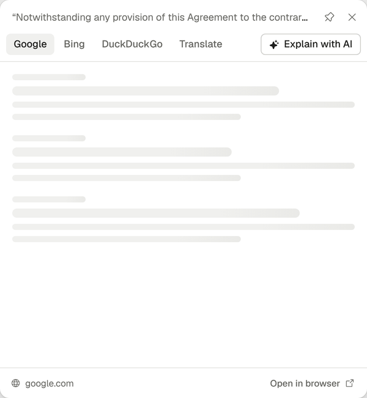

</div>

<br>

## Before and after

<table>
<tr>
<th width="50%">In the lease</th>
<th width="50%">On the card, at the Plain level</th>
</tr>
<tr>
<td>Notwithstanding any provision of this Agreement to the contrary, the Lessee shall remit payment of the monthly rent of $1,200 no later than the 5th day of each calendar month, failing which a late fee equivalent to 5% of the outstanding amount shall accrue.</td>
<td>Whatever else this agreement says, the tenant (the Lessee) must pay the monthly rent of $1,200 by the 5th day of each month. If they don't, a late fee of 5% of the unpaid amount is added.<br><br><sub>Reading grade 17 → 9</sub></td>
</tr>
</table>

## What's in it

<table>
<tr>
<td width="50%" valign="top">
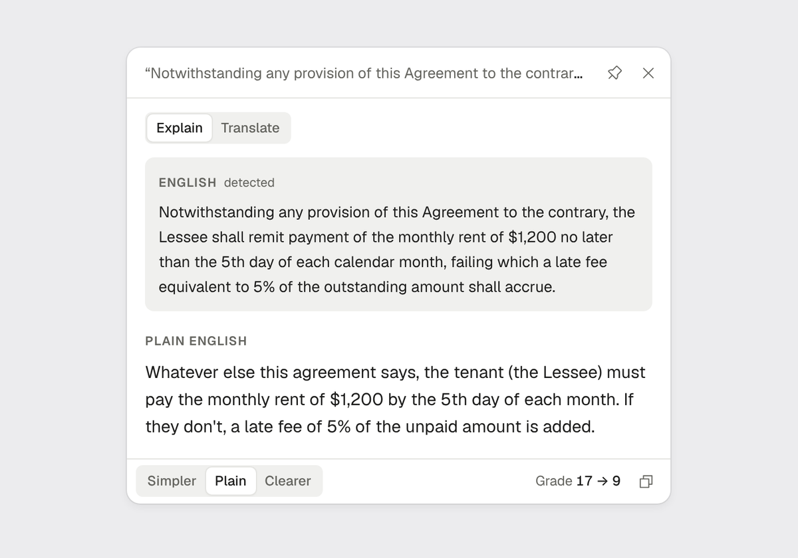
<h3>Explain in plain words</h3>
A small AI on your own computer rewrites jargon at the level you pick, keeps every number,
date and name, and shows the reading grade before and after.
</td>
<td width="50%" valign="top">
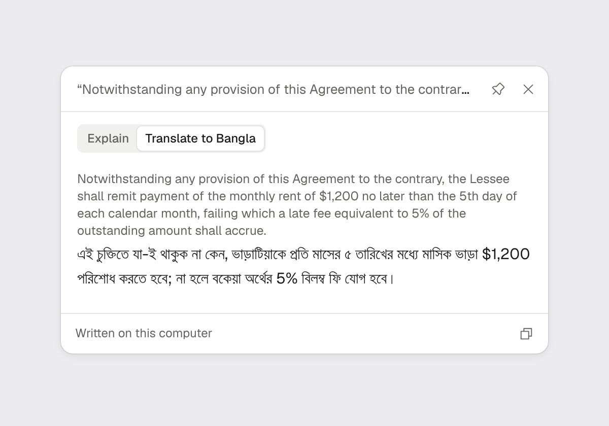
<h3>Translate privately</h3>
The same AI translates, so private text never leaves your computer. Each sentence sits
under its original, so you can map one onto the other. Google Translate is a tab away.
</td>
</tr>
<tr>
<td width="50%" valign="top">
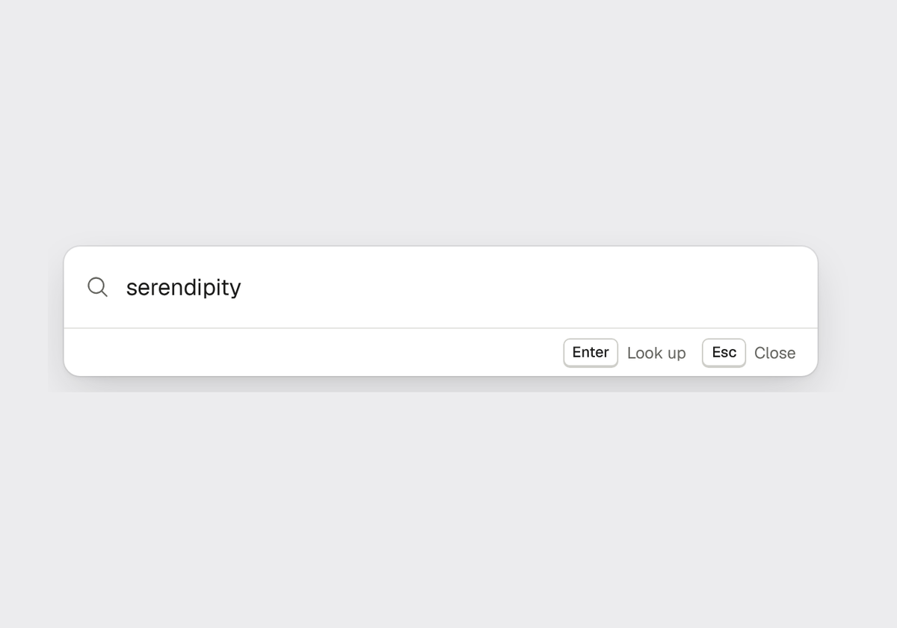
<h3>Look up anything</h3>
Heard a word in a lecture? Press the shortcut with nothing selected and type it. The same
card opens.
</td>
<td width="50%" valign="top">
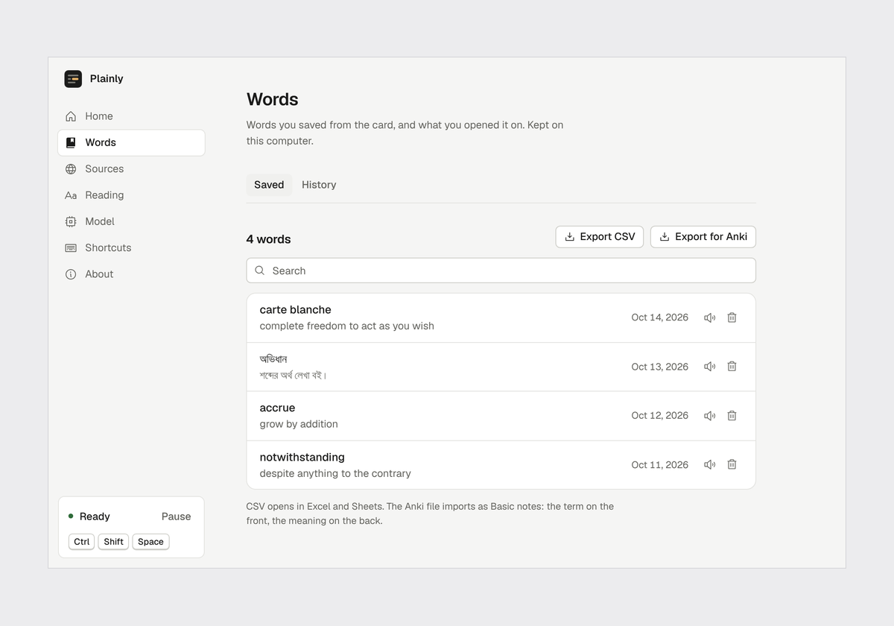
<h3>Keep your words</h3>
Save a word from the card, hear it read aloud, and export your list to Excel or Anki.
</td>
</tr>
</table>

**And:**

- **Searches first, AI when you ask.** Google, Bing, Wikipedia and any site you add open
  inside the card. The AI only runs when you open its tab, so quick lookups cost nothing.
- **A dictionary for single words**, built in and offline (WordNet).
- **It checks itself.** If an answer drops or invents a number, date or name, the card
  says so. A grammar keeps the model in the right language, token by token.
- **Any local model.** It recommends one that fits your PC, finds models you already have
  (LM Studio, Ollama, Jan, GPT4All, Hugging Face) and works with a local Ollama or LM
  Studio server.
- **Never in your way.** The card doesn't take focus from the app you're reading in. Esc
  or a click elsewhere closes it.

## Private by design

- The AI, the dictionary, your word book and your history stay on your computer.
- Web tabs are like visiting those sites, and load only when opened. **Offline only**
  turns them all off.
- It never reads selections in apps you choose. Password managers are on the list from
  the start.
- No account, no analytics, no server.

## Install

1. [Download the installer](https://github.com/omikhan4901/text_explainer/releases/download/latest-build/TextExplainer-x64-setup.exe)
   and run it. It isn't code-signed yet, so Windows shows a warning: choose
   **More info**, then **Run anyway**.
2. First run asks one question (search the web first, or offline only) and helps you pick
   a model that fits your memory, or use one you already have.
3. Select text anywhere and press **Ctrl+Shift+Space**, or press **Ctrl+C** twice.

The installer is rebuilt from every change and smoke-tested on a Windows machine before
it replaces the download.

<details>
<summary><b>More screenshots</b></summary>
<br>
<p>
  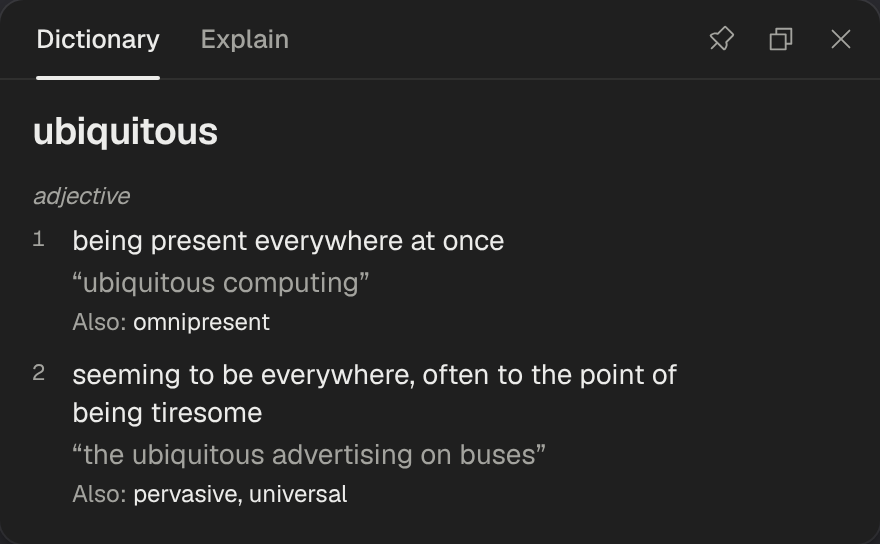
  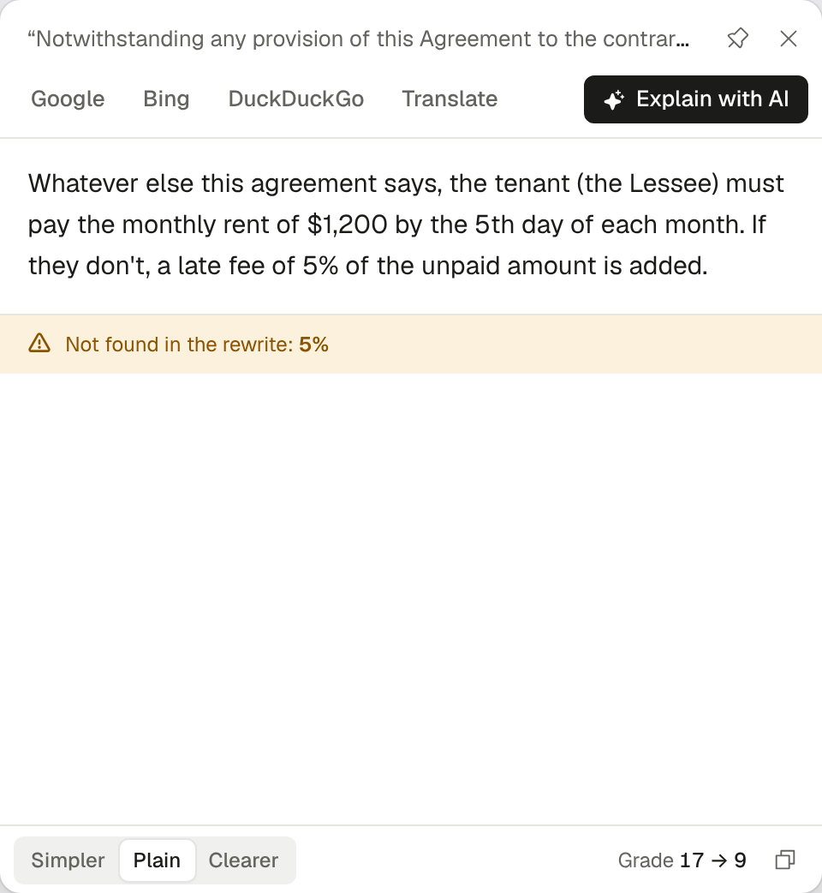
</p>
<p>
  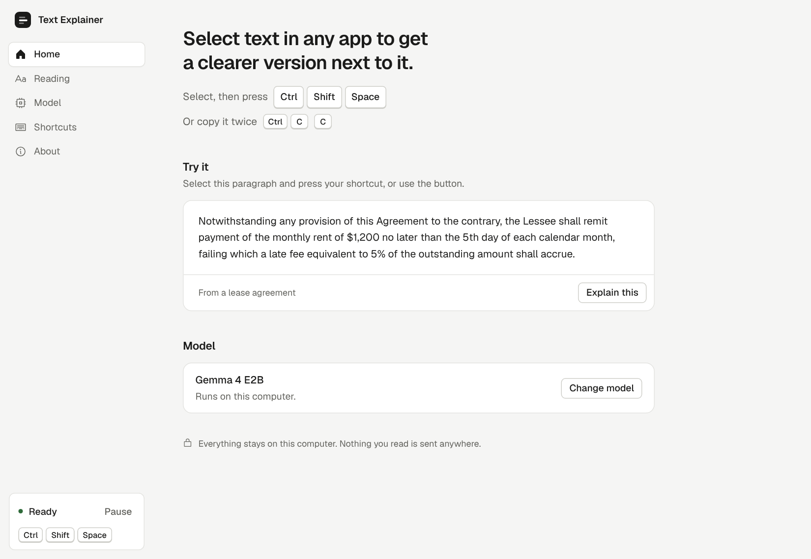
  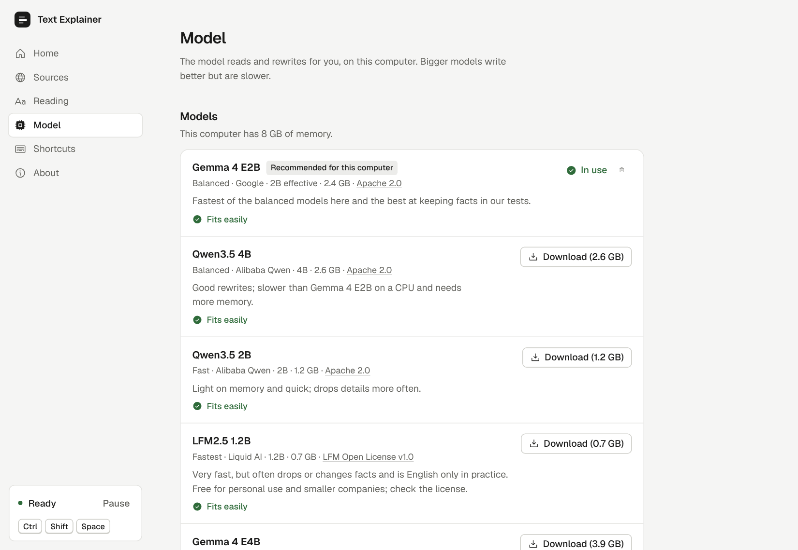
</p>
<p>
  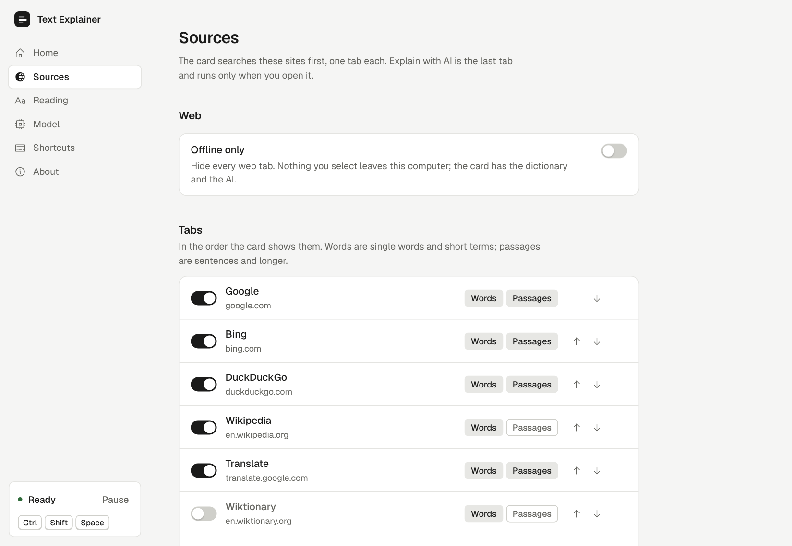
  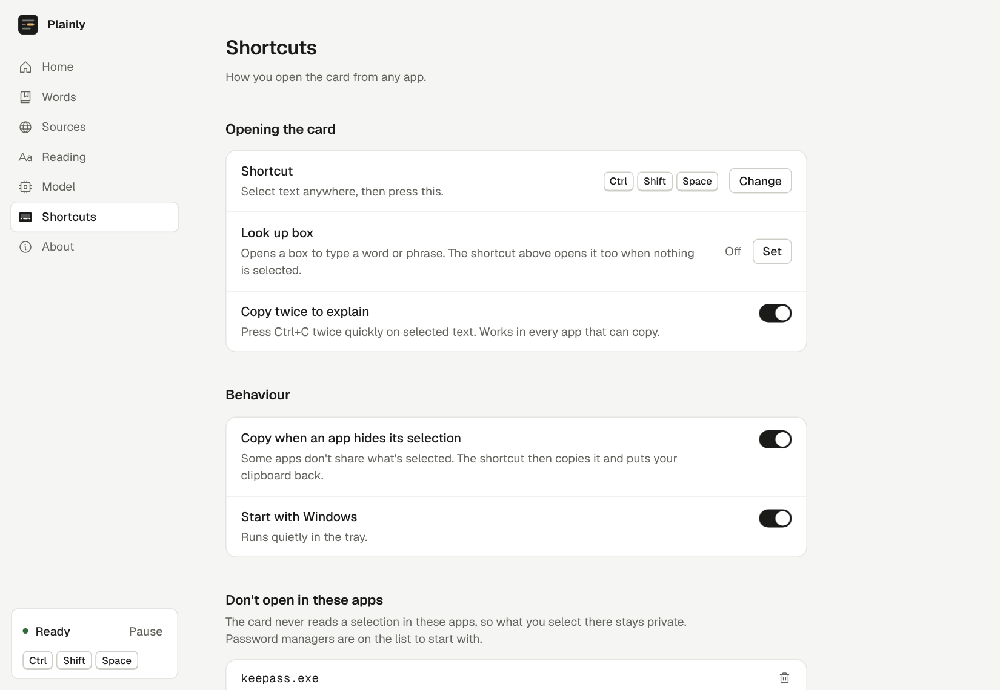
</p>
<sub>The real interface rendered against the app's built-in demo data.</sub>
</details>

## Measured, not guessed

The default model was chosen by an evaluation harness that runs 28 passages (legal,
medical, government, finance, news, plus Spanish, Bangla, Hindi and French) through each
model exactly as the app does, on a 4-core CI machine with no GPU
([full results](docs/models.md)):

| | Gemma 4 E2B (default) | Qwen3.5 4B | Qwen3.5 2B |
|---|---|---|---|
| Whole answer (median) | 5.8 s | 7.9 s | 5.4 s |
| First words (median) | 2.2 s | 2.4 s | 1.3 s |
| Peak memory | 3.9 GB | 4.7 GB | 2.1 GB |
| Answers with a fact flagged as missing | 1 of 56 | 2 of 56 | 8 of 56 |
| Answers in the wrong language | 0 | 0 | 0 |

Translation quality per language isn't measured yet; the harness has a translate task
for it.

## How it works

```
selection ─▶ UI Automation (or clipboard-safe copy) ─▶ repair PDF text ─▶ detect language
          ─▶ split long text ─▶ llama-server (grammar blocks other scripts) ─▶ hide chatter
          ─▶ meaning check + reading grade ─▶ the card
```

Rust · Tauri 2 · React + TypeScript · Tailwind CSS · Radix · llama.cpp · SQLite

194 Rust tests, 35 front-end unit tests and 92 Playwright checks (journeys and WCAG 2.2 AA
accessibility scans in light and dark) pass before every push. More in
[`docs/GUIDE.md`](docs/GUIDE.md) and [`docs/marketing/architecture.md`](docs/marketing/architecture.md).

<details>
<summary><b>Develop</b></summary>

```bash
npm ci
scripts/check.sh          # lint, types, tests, build, Rust checks, Windows type-check
E2E=1 scripts/check.sh    # plus the Playwright journeys and accessibility scans
npx vite                  # the interface in a browser against a mock: /popup.html?demo=passage
npm run tauri dev         # the app itself (Windows)
```

The plan is in [`docs/IMPLEMENTATION_PLAN.md`](docs/IMPLEMENTATION_PLAN.md), progress in
[`docs/PROGRESS.md`](docs/PROGRESS.md), conventions in [`CLAUDE.md`](CLAUDE.md).
</details>

## Status

A free preview for Windows. Every feature above is built and tested; the first test on a
real Windows desktop and the first numbered release are next. The interface is in English,
with every string ready for Bangla. macOS and Linux come later.

## License

MIT. Models have their own licenses, shown in the app before download.
